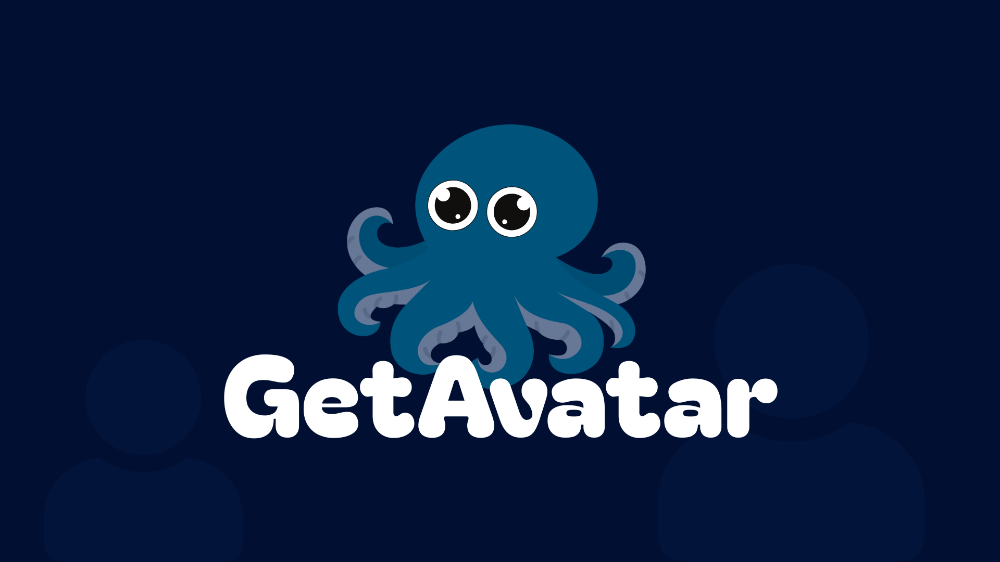

# Jellyfin Plugin GetAvatar

Jellyfin plugin that allows users to choose an avatar from a collection of images.



# About

This plugin allows users to choose an avatar from a collection of images. The plugin is installed in the Jellyfin server and provides a button in the user profile to select an avatar.

> [!NOTE]
> Tested with Jellyfin 10.11.0 and 10.11.10.
> Expected to work across Jellyfin 10.11.x.

## Installation

1. You have to open the dashboard of your Jellyfin server. Go to Catalog, click on ⚙️ button.
2. Click to + to add the URL.

```bash
https://raw.githubusercontent.com/cedev-1/Jellyfin-Plugin-GetAvatar/master/manifest.json
```

3. On the Catalog page click on Install.

## User View

User profile page will have a new button "Choose from Gallery".


### On TV (remote control)

On TV clients (Jellyfin TV layout, LG webOS, Samsung Tizen) the picker can be used with the remote: arrows move the selection, OK on an avatar sets it, Up reaches the category buttons (Left/Right to switch, OK to open one), Back closes the picker. Only one category is shown at a time, and only its images are loaded; avatars without a category are under "Other".

## Plugin Configuration

You just have to add avatar images, click on "Choose file" and "Upload". The image will be added to the collection of images. You can also remove images by clicking on the cross icon.


### Immich integration

The plugin can use an [Immich](https://immich.app/) server to fill the avatar gallery and to set profile pictures. Enable "Enable Immich" in the plugin settings, enter the server URL and an API key under "Immich connection", then turn on the features you want.

The API key only needs the permissions of the features you enable (create it in Immich, under the account settings):

| Feature | Permissions needed on the API key |
| --- | --- |
| Album import and sync | `album.read`, `asset.read`, `asset.view` |
| User profile pictures | `user.read`, `userProfileImage.read` |

For both features, give the key all five permissions. The album permissions alone are not enough for the user links.

**Album import and sync**

- Click "Import from Immich" to import one or more albums. Each album becomes a category. Re-importing only adds new photos, nothing is ever deleted.
- Click "Sync Immich albums" to fetch the photos added since to every album you imported. Photos removed from an album stay in the gallery.
- Up to 500 photos are imported per album.
- The imported photos are visible to every user.

**User profile pictures**

- Open "Immich users" and pick, for each Jellyfin user, their Immich user (or leave it empty).
- Click "Sync Immich profile pictures" to apply the Immich profile picture of each linked user. A picture is only applied if it changed in Immich since the last sync, so a user who picked another avatar keeps it until their Immich picture changes. In that case the sync reports the user as "unchanged".
- To get the Immich picture back for a user who picked another avatar, change their picture in Immich, or unlink and relink the user in "Immich users" (this resets what the plugin remembers).

The API key is stored unencrypted in the plugin configuration file.

> **TODO:**
> - Automatic sync of the imported albums and profile pictures (scheduled task / cron job). For now, use the sync buttons.
> - A "force sync" option for the user profile pictures, to re-apply the Immich picture even if it did not change.

## Avatar

> [!TIP]
> Now, since version 1.6.4.0, you can directly import avatars with one click from the plugin's configuration interface.

You can import avatar packs from the repository [jellyfin-avatars](https://github.com/cedev-1/jellyfin-avatars) or direct download from [web page](https://cedev-1.github.io/jellyfin-avatars/). 


For example, you can import this [Netflix avatar pack](https://imgur.com/gallery/netflix-all-profile-icons-ToZ21Gg).

## Client API

Jellyfin clients other than the web UI can list the avatar gallery and set a user's avatar through the plugin's HTTP API. See [API.md](./API.md) for the routes, authentication and versioning.

## Disclaimer

It may have some bugs. If you find any bug, please open an [issue](https://github.com/cedev-1/jellyfin-plugin-GetAvatar/issues).

# Troubleshooting

It is possible that on already active sessions the button is not displayed on the profile. You can clear your browser cache.

Possible problem with custom Jellyfin themes. Open an [issue](https://github.com/cedev-1/jellyfin-plugin-GetAvatar/issues) if needed.

## License

[MIT](./LICENSE)
